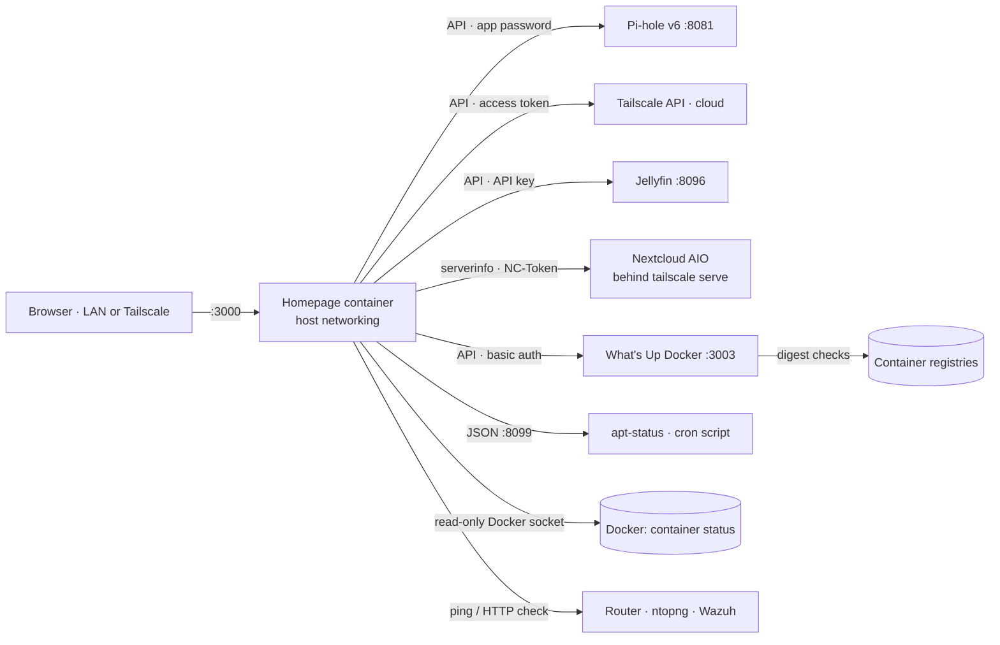

# Home Lab Dashboard with Homepage

A single self-hosted portal for every service in my home lab. It shows live stats from the DNS filter, VPN, media server and private cloud, up/down status for the network and security tools, and **pending updates** for every container and OS package. It's built with [Homepage](https://gethomepage.dev) running in Docker on an Ubuntu server.


<!-- Screenshot: blur any Tailscale IPs before committing -->

## What it does
- **One page for everything:** each service is a tile with a link, a live up/down indicator and, where supported, real-time stats.
- **Live widgets:**
  - Pi-hole: queries, blocked %, blocklist size
  - Tailscale: node address, last seen, update available
  - Jellyfin: library counts, active streams
  - Nextcloud: free space, users, files, shares
- **Update tracking:**
  - **Docker Images:** container image updates via What's Up Docker
  - **Ubuntu Packages:** apt updates, security updates, reboot pending
- **Server health bar:** CPU, RAM, disk and uptime of the host.
- **Extensible:** a new service is one YAML block, with no restart needed.

## Architecture



| Group | Tile | Data shown |
|---|---|---|
| Network | Pi-hole | queries, blocked (%), gravity |
| Network | Tailscale | tailnet address, last seen, update available |
| Network | ntopng | container status |
| Network | Router | ping status |
| Media | Jellyfin | movies / series / episodes / songs, now playing |
| Cloud | Nextcloud | free space, active users, files, shares |
| Cloud | Nextcloud AIO | container status |
| Security | Wazuh SIEM | HTTP status |
| Updates | Docker Images | containers monitored, updates available |
| Updates | Ubuntu Packages | pending updates, security updates, reboot needed, last checked |

## Environment
| Item | Value |
|---|---|
| Host | Dell XPS 8700, Ubuntu, Docker |
| Server LAN IP | `192.168.68.56` |
| Dashboard | `http://192.168.68.56:3000` (LAN) or `http://<server-hostname>:3000` (Tailscale) |
| Related ports | 3001 Uptime Kuma (planned) · 3002 ntopng · 3003 What's Up Docker · 127.0.0.1:8099 apt status |
| RAM use | about 100–150 MB for Homepage, plus a small amount for WUD and busybox |

**Placeholders used below:** `<server-hostname>` is the server's Tailscale machine name, `<tailnet>` is the tailnet's `*.ts.net` domain, and `<server-tailnet-ip>` is the server's `100.x` Tailscale address.

---

## Part 1: Dashboard

All files live in `~/homepage/`. Write them with a heredoc (`cat > file <<'EOF'` … `EOF`) or `nano`.

### 1. `docker-compose.yml`
```yaml
services:
  homepage:
    image: ghcr.io/gethomepage/homepage:latest
    container_name: homepage
    network_mode: host                # needed to reach Nextcloud behind tailscale serve
    env_file: .env                    # secrets stay out of the config files
    environment:
      # Every hostname:port used in the browser. Missing one = "Host validation failed".
      HOMEPAGE_ALLOWED_HOSTS: "192.168.68.56:3000,<server-tailnet-ip>:3000,<server-hostname>:3000,<server-hostname>.<tailnet>.ts.net:3000"
    volumes:
      - ./config:/app/config
      - /var/run/docker.sock:/var/run/docker.sock:ro   # container up/down status
    restart: unless-stopped
    labels:
      - wud.watch=true
      - wud.watch.digest=true
```

### 2. `.env` (secrets)
```ini
HOMEPAGE_VAR_PIHOLE_KEY=
HOMEPAGE_VAR_JELLYFIN_KEY=
HOMEPAGE_VAR_NEXTCLOUD_TOKEN=
HOMEPAGE_VAR_TAILSCALE_DEVICE=
HOMEPAGE_VAR_TAILSCALE_KEY=
HOMEPAGE_VAR_WUD_USER=
HOMEPAGE_VAR_WUD_PASS=
```
```bash
chmod 600 ~/homepage/.env
echo ".env" > ~/homepage/.gitignore
```
Homepage substitutes `{{HOMEPAGE_VAR_NAME}}` in the YAML with these values, so the config files can be published safely. The source of truth for every key is a password manager (Bitwarden).

| Key | How to create it | Expires |
|---|---|---|
| Pi-hole | **Settings → Web interface / API → Expert → Configure app password**, then click **Enable new app password**. Verify with `docker exec pihole pihole-FTL --config webserver.api.app_pwhash`. | No |
| Jellyfin | **Dashboard → API Keys → +** (a dedicated `homepage` key) | No |
| Nextcloud | `TOKEN=$(openssl rand -hex 24)`, then `sudo docker exec --user www-data nextcloud-aio-nextcloud php occ config:app:set serverinfo token --value "$TOKEN"`, then `sed -i "s/^HOMEPAGE_VAR_NEXTCLOUD_TOKEN=.*/HOMEPAGE_VAR_NEXTCLOUD_TOKEN=$TOKEN/" ~/homepage/.env` | No |
| Tailscale device ID | Admin console → Machines → server → Machine Details → **ID** (ends in `CNTRL`) | No |
| Tailscale API token | Admin console → Settings → Keys → **Generate access token** | **Yes, 90 days max.** A rotation reminder is scheduled 5 days before expiry. |
| WUD user / password | Same values as WUD's admin login (Part 2) | No |

### 3. `config/settings.yaml`
```yaml
title: Home Lab
theme: dark
color: slate
headerStyle: boxed
statusStyle: dot
hideVersion: true
layout:
  Network:
    style: row
    columns: 4
  Media:
    style: row
    columns: 2
  Cloud:
    style: row
    columns: 2
  Security:
    style: row
    columns: 2
  Updates:
    style: row
    columns: 2
```

### 4. `config/docker.yaml`
```yaml
xps:
  socket: /var/run/docker.sock
```

### 5. `config/services.yaml`
```yaml
- Network:
    - Pi-hole:
        icon: pi-hole.png
        href: http://192.168.68.56:8081/admin
        description: Network-wide DNS ad blocking
        server: xps
        container: pihole
        widget:
          type: pihole
          url: http://192.168.68.56:8081
          version: 6
          key: "{{HOMEPAGE_VAR_PIHOLE_KEY}}"
    - Tailscale:
        icon: tailscale.png
        href: https://login.tailscale.com/admin/machines
        description: Subnet router + exit node
        widget:
          type: tailscale
          deviceid: "{{HOMEPAGE_VAR_TAILSCALE_DEVICE}}"
          key: "{{HOMEPAGE_VAR_TAILSCALE_KEY}}"
          fields: ["address", "last_seen", "update_available"]
    - ntopng:
        icon: ntopng.png
        href: http://192.168.68.56:3002
        description: Live traffic monitoring
        server: xps
        container: ntopng
    - Router:
        icon: tp-link.png
        href: http://192.168.68.1
        description: TP-Link Deco AX1500
        ping: 192.168.68.1

- Media:
    - Jellyfin:
        icon: jellyfin.png
        href: http://192.168.68.56:8096
        description: Movies, shows and live TV
        server: xps
        container: jellyfin
        widget:
          type: jellyfin
          url: http://192.168.68.56:8096
          key: "{{HOMEPAGE_VAR_JELLYFIN_KEY}}"
          version: 2                  # Jellyfin 10.12+ (tested on 12.4.0) dropped the /emby endpoints
          enableBlocks: true
          enableNowPlaying: true

- Cloud:
    - Nextcloud:
        icon: nextcloud.png
        href: https://<server-hostname>.<tailnet>.ts.net
        description: Files, photos, calendar
        server: xps
        container: nextcloud-aio-nextcloud
        widget:
          type: nextcloud
          url: https://<server-hostname>.<tailnet>.ts.net
          key: "{{HOMEPAGE_VAR_NEXTCLOUD_TOKEN}}"
    - Nextcloud AIO:
        icon: nextcloud-blue.png
        href: https://192.168.68.56:8080
        description: AIO admin, updates and backups
        server: xps
        container: nextcloud-aio-mastercontainer

- Security:
    - Wazuh:
        icon: wazuh.png
        href: https://192.168.68.56:5601
        description: SIEM · alerts and vulnerability detection
        siteMonitor: https://192.168.68.56:5601

- Updates:
    - Docker Images:
        icon: whats-up-docker.png
        href: http://192.168.68.56:3003
        description: Container image updates
        server: xps
        container: wud
        widget:
          type: whatsupdocker
          url: http://127.0.0.1:3003
          username: "{{HOMEPAGE_VAR_WUD_USER}}"
          password: "{{HOMEPAGE_VAR_WUD_PASS}}"
    - Ubuntu Packages:
        icon: si-ubuntu-#E95420
        description: OS, Docker, Tailscale, Wazuh agent (apt)
        widget:
          type: customapi
          url: http://127.0.0.1:8099/status.json
          refreshInterval: 300000
          mappings:
            - field: packages
              label: Updates
              format: number
            - field: security
              label: Security
              format: number
            - field: reboot
              label: Reboot needed
            - field: checked
              label: Checked
              format: relativeDate
```

### 6. `config/widgets.yaml`
```yaml
- resources:
    label: Server
    cpu: true
    memory: true
    disk: /
    uptime: true
- datetime:
    text_size: xl
    format:
      dateStyle: medium
      timeStyle: short
- search:
    provider: duckduckgo
    target: _blank
```

### 7. `config/bookmarks.yaml`
```yaml
- Admin:
    - Tailscale Console:
        - abbr: TS
          href: https://login.tailscale.com/admin
    - Router:
        - abbr: RT
          href: http://192.168.68.1
    - Switch:
        - abbr: SW
          href: http://192.168.68.52
```

### 8. Start
```bash
cd ~/homepage && docker compose up -d
docker logs --tail 20 homepage
```
YAML edits apply on page refresh. Changes to `.env` or the compose file need `docker compose up -d`.

---

## Part 2: Update tracking

Two sources, because there are two kinds of software on the server:

| Tile | Covers | Method |
|---|---|---|
| Docker Images | Pi-hole, Jellyfin, ntopng, Redis, Homepage, WUD | **What's Up Docker (WUD)**, which detects updates only and never installs them |
| Ubuntu Packages | OS, Docker Engine, Tailscale, Wazuh agent | A cron script writes `status.json`; Homepage reads it with the `customapi` widget |

**Not tracked on purpose:** Nextcloud AIO, which updates its own containers from its admin page. Updating them by hand can break it.

### 1. `~/updates/docker-compose.yml`
```yaml
services:
  wud:
    image: getwud/wud:latest
    container_name: wud
    env_file: .env                                # admin login (WUD 9.x requires one)
    ports:
      - "3003:3000"                               # WUD defaults to 3000, which Homepage uses
    environment:
      - TZ=America/Chicago
      - WUD_WATCHER_LOCAL_WATCHBYDEFAULT=false    # opt-in: only containers labeled wud.watch=true
      - WUD_WATCHER_LOCAL_CRON=0 */6 * * *        # check every 6 hours
    volumes:
      - /var/run/docker.sock:/var/run/docker.sock:ro
      - ./wud:/store
    labels:
      - wud.watch=true
    restart: unless-stopped
  apt-status:
    image: busybox:latest
    container_name: apt-status
    network_mode: host
    command: httpd -f -p 127.0.0.1:8099 -h /www   # serves status.json on localhost only
    volumes:
      - ./apt:/www:ro
    restart: unless-stopped
```

### 2. WUD admin login (`~/updates/.env`)
```bash
WUD_PASS=$(openssl rand -base64 18 | tr -d '/+=')
echo "WUD password: $WUD_PASS"        # store in the password manager
printf 'WUD_AUTH_ADMIN_USER=admin\nWUD_AUTH_ADMIN_PASSWORD=%s\n' "$WUD_PASS" > ~/updates/.env
chmod 600 ~/updates/.env && echo ".env" > ~/updates/.gitignore
printf 'HOMEPAGE_VAR_WUD_USER=admin\nHOMEPAGE_VAR_WUD_PASS=%s\n' "$WUD_PASS" >> ~/homepage/.env
```

### 3. apt check script (`/usr/local/bin/apt-status.sh`)
```bash
#!/bin/bash
OUT=$HOME_DIR/updates/apt/status.json      # set to the real path, e.g. /home/<user>/updates/apt/status.json
apt-get update -qq >/dev/null 2>&1
LIST=$(apt list --upgradable 2>/dev/null | tail -n +2)
PKGS=$(printf '%s\n' "$LIST" | grep -c .)
SEC=$(printf '%s\n' "$LIST" | grep -c -- '-security')
REBOOT=$([ -f /var/run/reboot-required ] && echo Yes || echo No)
printf '{"packages":%d,"security":%d,"reboot":"%s","checked":"%s"}\n' \
  "$PKGS" "$SEC" "$REBOOT" "$(date -Iseconds)" > "$OUT.tmp" && mv "$OUT.tmp" "$OUT"
```
```bash
sudo chmod 755 /usr/local/bin/apt-status.sh
echo '17 */6 * * * root /usr/local/bin/apt-status.sh' | sudo tee /etc/cron.d/apt-status
sudo /usr/local/bin/apt-status.sh && cat ~/updates/apt/status.json
# {"packages":14,"security":0,"reboot":"Yes","checked":"..."}
```
It only checks for updates and never installs them. The temp-file-then-`mv` step keeps Homepage from ever reading a half-written file.

### 4. Opt containers in to WUD
WUD tracks image checksums (digest watching) by default, **except for Docker Hub images**. Most of these services use Docker Hub `latest` tags, so each needs both labels:
```yaml
    labels:
      - wud.watch=true
      - wud.watch.digest=true
```
To add them to every compose project at once (backs up each file, validates before restarting):
```bash
for d in $(for c in pihole ntopng homepage jellyfin; do docker inspect $c --format '{{ index .Config.Labels "com.docker.compose.project.working_dir" }}' 2>/dev/null; done | sort -u); do
  cp "$d/docker-compose.yml" "$d/docker-compose.yml.bak"
  sed -i 's/^    restart: unless-stopped$/    restart: unless-stopped\n    labels:\n      - wud.watch=true\n      - wud.watch.digest=true/' "$d/docker-compose.yml"
  (cd "$d" && docker compose config -q && docker compose up -d)
done
```
Restarting Pi-hole interrupts household DNS for about 10 seconds.

### 5. Start and test
```bash
cd ~/updates && docker compose up -d
docker ps --filter name=wud --format '{{.Status}}'                       # Up, not Restarting
curl -s -o /dev/null -w '%{http_code}\n' -u "admin:$WUD_PASS" http://127.0.0.1:3003/api/containers   # 200
curl -s http://127.0.0.1:8099/status.json
```
The WUD web UI at `http://192.168.68.56:3003` lists exactly which containers have updates.

### Applying updates (manual, on my schedule)
- **Containers:** `cd <service folder> && docker compose pull && docker compose up -d`
- **Ubuntu packages:** `sudo apt upgrade`, then reboot if the tile says so, then run the post-reboot checks (DNS, Tailscale interface, `docker ps`). The server is the network's DNS resolver, so a bad reboot affects the whole house.

---

## Problems solved during deployment

Each widget failed for a different reason. Reading the HTTP status or startup error in the logs pointed to each root cause.

| Symptom | Log evidence | Root cause | Fix |
|---|---|---|---|
| Pi-hole "API Error" | `Failed to login to Pi-Hole API, status: 401` | App password was generated but never activated | Click **Enable new app password**; verify the hash exists |
| Jellyfin "API Error" | `HTTP Error 404 calling .../emby/Sessions` | Newer Jellyfin removed the legacy `/emby` endpoints | `version: 2` in the widget |
| Nextcloud "API Error" | `ENETUNREACH fd7a:...:443`, `HTTP Error 500` | Nextcloud listens only on localhost behind `tailscale serve`, which a bridge-networked container can't reach | `network_mode: host` |
| Tailscale "API Error" | `HTTP Error 404 calling .../device/` | Device ID not set yet | Add the ID ending in `CNTRL` |
| Docker Images "API Error", orange dot, WUD `Restarting` | `Authentication is mandatory: No administrator user found` | WUD 9.x refuses to start without an admin login | Set `WUD_AUTH_ADMIN_USER` / `WUD_AUTH_ADMIN_PASSWORD`; pass the same credentials to the widget |
| Ubuntu tile shows a broken image | n/a | `ubuntu.png` isn't in the icon set | Use Simple Icons: `si-ubuntu-#E95420` |

**Test commands (no secrets printed):**
```bash
# Is a key loaded in the container? (>1 = yes)
docker exec homepage printenv HOMEPAGE_VAR_PIHOLE_KEY | wc -c

# Does Pi-hole accept the key?
source <(grep PIHOLE_KEY ~/homepage/.env)
curl -s -X POST http://192.168.68.56:8081/api/auth -H 'Content-Type: application/json' \
  -d "{\"password\":\"$HOMEPAGE_VAR_PIHOLE_KEY\"}" | grep -o '"valid":[a-z]*'

# Does Jellyfin still serve legacy endpoints? (404 = use version: 2)
curl -s -o /dev/null -w '%{http_code}\n' http://192.168.68.56:8096/emby/System/Info/Public

# Does the Nextcloud token work?
curl -s -H "NC-Token: $(grep NEXTCLOUD_TOKEN ~/homepage/.env | cut -d= -f2)" \
  "https://<server-hostname>.<tailnet>.ts.net/ocs/v2.php/apps/serverinfo/api/v1/info?format=json" | head -c 200
```

**Other tips:**
- **"Host validation failed":** add the exact `host:port` to `HOMEPAGE_ALLOWED_HOSTS`.
- **Gray dashes on a widget:** it's still loading. Hard refresh with Ctrl+F5.
- **Wazuh shows red while up:** the self-signed certificate can trip `siteMonitor`. Use a container status check instead.
- **Pasting YAML into the shell** gives `command not found`. Use a heredoc, `sed`, or an editor.
- **WUD shows 0 updates for `latest` images:** the container is missing `wud.watch.digest=true`.

## Security decisions
- **Secrets in `.env` files**, excluded from Git, with a password manager as the source of truth.
- **Least-privilege, revocable credentials:**
  - Pi-hole app password instead of the admin password
  - a dedicated Jellyfin key
  - a read-only Nextcloud serverinfo token
- **Read-only Docker socket** for Homepage and WUD. Socket access is still powerful, so the dashboard and WUD stay LAN/Tailscale-only and are never exposed publicly.
- **Detection, not auto-updating:** WUD and the apt script only report. Updates are applied by hand, so a bad image or kernel never surprises the household's DNS server.
- **The apt status endpoint is bound to `127.0.0.1`** and isn't reachable from the network.
- **Planned rotation** of the only expiring credential (the Tailscale API token).

## Roadmap
- Tiles for Portainer, Uptime Kuma, Nginx Proxy Manager, Vaultwarden and Home Assistant as each is deployed
- HTTPS name (`home.<domain>`) through Nginx Proxy Manager
- WUD notifications (Discord or ntfy) when new updates appear
- Weather widget, and a wall-mounted tablet view
