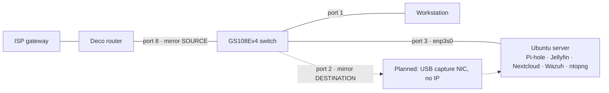

# Network Traffic Monitoring with ntopng

Live traffic visibility for a home lab network, using **ntopng Community Edition** in Docker on an Ubuntu server, fed by port mirroring (SPAN) on a managed switch. It shows which devices use bandwidth, which protocols and applications they run (via nDPI deep packet inspection), and live flows checked against threat-intelligence blocklists.


## Environment
| Item | Value |
|---|---|
| Host | Dell XPS 8700, Ubuntu, Docker (host networking) |
| Server LAN IP | `192.168.68.56` |
| Web UI | `http://192.168.68.56:3002` |
| Switch | Netgear GS108Ev4 (managed, supports port mirroring) |
| Router | TP-Link Deco AX1500 mesh |
| Edition | Community (free, no license file) |

**Why port 3002:** ntopng defaults to 3000, which the Homepage dashboard uses, and 3001 is reserved for Uptime Kuma.

## Architecture



**Switch config:** System → Monitoring → Mirroring, source **port 8** (router uplink) → destination **port 2**.

### Current state
- ✅ ntopng running and capturing on the server's main NIC (`enp3s0`)
- ⚠️ The mirror destination (port 2) isn't connected to the server yet, so ntopng currently sees **traffic to and from the server only**:
  - every device's DNS queries to Pi-hole
  - media streams from Jellyfin
  - Nextcloud syncs
  - VPN traffic
- **Next step:** a dedicated USB capture NIC on port 2 (see "Connecting the mirror")

### Visibility once the mirror is connected
| Traffic | Visible? | Why |
|---|---|---|
| Wired devices ↔ internet | ✅ | crosses the router uplink (port 8) |
| Wi-Fi devices ↔ server | ✅ | crosses port 8 to reach the server |
| Wired devices ↔ server | ✅ | captured on the server NIC |
| Wi-Fi devices ↔ internet | ❌ | the mesh router sends it straight to the ISP gateway; it never touches the switch |

Understanding where a tap sits, and what it can't see, is half the design. Full visibility would need the sensor inline between the router and the ISP gateway, or a firewall like OPNsense as the main router. Pi-hole's per-client DNS logs fill the Wi-Fi gap for now.

---

## Setup

### 1. Check resources
```bash
free -h            # look at "available", not "free"
vmstat 1 5         # si/so (swap in/out) near 0 = no memory pressure
```
ntopng plus Redis needs roughly 300–500 MB. The server had 4.0 GiB available. The old swap use was idle (`so` = 0), so there was plenty of headroom.

### 2. `~/ntopng/docker-compose.yml`
```yaml
services:
  redis:
    image: redis:alpine
    container_name: ntopng-redis
    network_mode: host
    command: redis-server --bind 127.0.0.1 --port 6379
    volumes:
      - ./redis:/data               # users, passwords, device aliases persist
    restart: unless-stopped
  ntopng:
    image: ntop/ntopng:latest
    container_name: ntopng
    environment:
      - TZ=America/Chicago
    network_mode: host              # required to capture on a physical NIC
    cap_add: [NET_ADMIN, NET_RAW]
    depends_on: [redis]
    volumes:
      - ./data:/var/lib/ntopng      # time series and settings
    command: --community -i enp3s0 -w 3002 -m 192.168.68.0/22,100.64.0.0/10 --redis 127.0.0.1:6379
    restart: unless-stopped
```
| Flag | Purpose |
|---|---|
| `--community` | free edition, no license |
| `-i enp3s0` | capture interface |
| `-w 3002` | web UI port |
| `-m ...` | marks the LAN and the Tailscale CGNAT range as local networks |
| `--redis 127.0.0.1:6379` | Redis bound to localhost only |

```bash
cd ~/ntopng && docker compose up -d
sudo ss -tlnp | grep 3002          # can take 30–60 s while threat lists load
docker logs --tail 30 ntopng       # ends with: Started polling on interface 'enp3s0'
```

### 3. First login
1. Open `http://192.168.68.56:3002` and log in with `admin` / `admin`. Change the password right away.
2. Give known devices aliases: click a host → pencil icon.
3. Disable any threat lists that fail to download (see Troubleshooting).

---

## Connecting the mirror

### Option A (recommended): dedicated capture NIC
1. Add a USB 3.0 gigabit adapter (RTL8153 or AX88179 chipset) and connect it to switch port 2.
2. Bring it up **with no IP address**, as a passive, one-way tap. Create `/etc/netplan/60-mirror.yaml`:
   ```yaml
   network:
     version: 2
     ethernets:
       enx<adapter-mac>:
         dhcp4: false
         dhcp6: false
         link-local: []
         optional: true
   ```
   ```bash
   sudo chmod 600 /etc/netplan/60-mirror.yaml && sudo netplan apply
   ```
3. Check that mirrored packets arrive: `sudo tcpdump -i enx<adapter-mac> -n -c 30`. You should see other hosts' traffic.
4. Add the interface to ntopng: `-i enp3s0 -i enx<adapter-mac>`.

### Option B: mirror to the server's existing port
This is free, but on some switches the mirror destination stops passing normal traffic. The server is the network's DNS resolver, so that would take the whole house offline. Rejected for that reason.

---

## Troubleshooting
| Symptom | Cause | Fix |
|---|---|---|
| Log: `Abuse.ch URLhaus` / `ThreatFox` … `HTTP Code: 410`, "0 rules" | Those feed URLs have been retired (410 Gone) | Disable both under Settings → Category Lists. The other feeds (Emerging Threats, IPsum, Stratosphere, dshield, NoCoin) still load about 51k IPs. |
| Nothing on port 3002 right after start | Startup is still refreshing threat lists | Wait 30–60 s |
| Port conflict with the dashboard | Default port 3000 | `-w 3002` |
| Login resets to admin/admin after a rebuild | Redis had no persistent volume | Mount `./redis:/data` |
| Only the server's own traffic shows | Mirror port not connected to the capture interface | Connect the capture NIC (Option A) |
| Interface not found | Typo or unplugged adapter | Compare with `ip -br link` |
| Mirrored stats drop at high load | Port 8 traffic in both directions can exceed a single 1 Gbps port | Expected on a home switch |

## Security decisions
- The UI stays LAN/Tailscale-only and is never exposed publicly.
- Redis is bound to `127.0.0.1`.
- The planned capture NIC has no IP, so it can't be reached from the network.
- Threat-intelligence lists flag traffic to known-bad IPs and domains.

## Skills demonstrated
- Port mirroring / SPAN configuration on a managed switch
- Passive network tap design, and analysis of what a tap can and can't see
- Deep packet inspection (nDPI) and flow analysis
- Containerized deployment with host networking and Linux capabilities (`NET_RAW`, `NET_ADMIN`)
- Resource planning on a shared host (`free`, `vmstat`, swap analysis)

## Roadmap
- Dedicated capture NIC on the mirror port
- Forward ntopng alerts to syslog and into Wazuh, so network and endpoint alerts land in one SIEM
- Uptime Kuma monitor for the ntopng UI
- Long term: an OPNsense firewall for full visibility, including Wi-Fi-to-internet traffic
