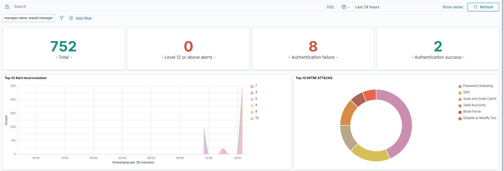

# Wazuh SIEM — Home Lab Security Monitoring

## Goal
Get hands-on SOC experience by running a SIEM (security information and event management) system on my own network. The goal was to collect logs from my Linux server and Windows desktop in one place, catch suspicious activity, and practice reading and triaging real alerts.

## Environment
| Component | Details |
|---|---|
| Server | Dell XPS 8700 running Ubuntu 26.04 LTS (8 GB RAM), already hosting Pi-hole, Jellyfin and Nextcloud in Docker |
| SIEM | Wazuh 4.14.10: manager, indexer (OpenSearch) and dashboard, deployed with Docker Compose |
| Agents | Ubuntu server (apt package) and Windows 11 desktop (MSI) |
| Remote access | Tailscale, so the dashboard is reachable from anywhere on my tailnet without opening ports to the internet |

## Architecture
```
Ubuntu host agent ──┐
                    ├──▶ Wazuh manager ──▶ Wazuh indexer ──▶ Wazuh dashboard ◀── Browser (LAN / Tailscale)
Windows 11 agent ───┘     (Docker)          (Docker)          (Docker, :5601)
```
The SIEM runs in containers. The Ubuntu host is monitored by a separate native agent that reports to the manager container, the same way any other endpoint would.

## What I did

### 1. Planned around limited resources
- Checked RAM and disk before installing. About 3.8 GB was free next to the existing services.
- Cut the indexer's Java heap from 1 GB to 512 MB so the full stack fits on an 8 GB machine.
- Set `vm.max_map_count=262144`, which OpenSearch requires, and made it survive reboots.

### 2. Deployed the stack with Docker Compose
```bash
git clone https://github.com/wazuh/wazuh-docker.git -b v4.14.10
cd wazuh-docker/single-node
sed -i 's/- 443:5601/- 5601:5601/' docker-compose.yml
sed -i 's/-Xms1g -Xmx1g/-Xms512m -Xmx512m/' docker-compose.yml
docker compose -f generate-indexer-certs.yml run --rm generator
docker compose up -d
```
- **Port conflict:** the dashboard defaults to 443, which Tailscale already uses for my Nextcloud instance, so I moved the dashboard to 5601.
- Pinned every component to the same version. Wazuh only guarantees compatibility when the manager is the same version as the agents or newer, so I also put the Linux agent package on hold to block automatic upgrades.

### 3. Enrolled endpoints
- **Linux:** added Wazuh's signed apt repository, installed the agent pointed at the manager, and enabled the service.
- **Windows:** installed the MSI silently from an admin PowerShell, with verbose installer logging so failures could be diagnosed.

### 4. Hardened the deployment
- Replaced the default admin and API credentials, which are published in the public repository. For the admin account, that meant generating a bcrypt hash, updating the indexer's internal users file, and applying it with OpenSearch's `securityadmin.sh` tool.
- Stored all credentials in a password manager, not in config notes.
- The dashboard is reachable only on my LAN and tailnet, not exposed to the internet.

## Results

### First detection: SSH brute-force test
I simulated an attack by making repeated failed SSH logins from the Windows desktop to the server. Wazuh:
- logged **8 authentication failures** and 2 successful logins (`sshd`, `pam` and `authentication_failed` rule groups)
- correlated the repeated failures into a higher-severity **level 10 alert**
- automatically mapped the events to **PCI DSS 10.2.4** (invalid logical access attempts) and **10.2.5** (use of identification and authentication mechanisms)
- tagged them with **MITRE ATT&CK** techniques, including Password Guessing, Brute Force and Valid Accounts



This showed the full chain working: endpoint log → agent → manager rule match → correlation → indexed alert → dashboard.

### Ongoing visibility
- File integrity monitoring and a vulnerability inventory for both endpoints
- Rootcheck and AppArmor findings to triage, as alert-investigation practice

## Troubleshooting

| Problem | Cause | Fix |
|---|---|---|
| Linux agent: `Unable to connect to enrollment service` | Agent was installed with a stale manager IP from another network | Corrected the manager address in `ossec.conf` and restarted. The agent connected right away. |
| Windows: `NET START Wazuh` → "service name is invalid" | `msiexec` returns before the install finishes, so the service didn't exist yet | Switched to `Start-Process msiexec ... -Wait` |
| Windows MSI **Error 1720**: `VBScript runtime error: Input past end of file` | Read the verbose MSI log. A leftover **0-byte `ossec.conf`** made the installer treat it as an upgrade, and its script failed reading the empty file. | Renamed the leftover install folder and reinstalled. The service started and the agent enrolled. |
| Service lookup failed even after install | The service name is `WazuhSvc`. "Wazuh" is only the display name. | Queried the correct name (found in the MSI log) |
| New admin password rejected while the old one still worked | The new hash was saved, but the security configuration hadn't been pushed to the indexer | Ran `securityadmin.sh` in a single `docker exec` so its variables carried through, then confirmed with an authenticated `curl` to the indexer API before restarting the dashboard |
| Swap rose to about 1.4 GB on first start | One-time vulnerability database download plus initial agent baselining | Monitored with `docker stats` and `free -h`. Fallback plans: trim unused Nextcloud add-ons or upgrade the RAM. |

## Skills demonstrated
- SIEM deployment and configuration (Wazuh / OpenSearch)
- Docker Compose, container networking and resolving port conflicts
- Linux administration: apt repositories and GPG keys, systemd, kernel parameters
- Windows endpoint deployment: silent MSI installs, PowerShell, reading installer logs
- Detection testing and alert triage (rule levels, correlation, compliance mapping)
- Credential hardening and secure remote access (Tailscale)
- Planning around capacity limits on modest hardware

## Next steps
- Add **Suricata** network IDS and forward its alerts into Wazuh
- Run scheduled **Greenbone/OpenVAS** vulnerability scans
- Write custom Wazuh rules and test them against MITRE ATT&CK techniques
- Upgrade the server RAM to run the indexer at full heap
